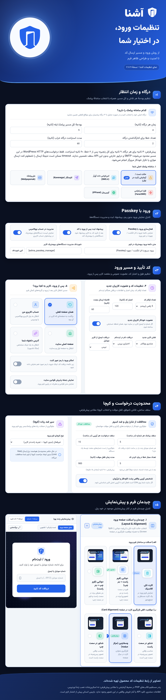

<!--
پیش‌نویس کمکی برای بازنویسی و تأیید انسانی؛ متن تولیدشده با کمک هوش مصنوعی است.
راهنمای راست‌چین استفاده از هوش مصنوعی برای متن و تصویر را ممنوع کرده است؛
این فایل تضمین انطباق با آن بند یا تأیید انتشار نیست و نباید بدون بازنویسی انسانی ارسال شود.
ساختار: دو خط معرفی، پنج ویژگی اصلی، محل یک اینفوگرافیک و فهرست خطی امکانات.
-->

# افزونه آشنا؛ ورود و ثبت‌نام وردپرس با کد یکبارمصرف و Passkey

## معرفی محصول

آشنا افزونه ورود و ثبت‌نام وردپرس با کد یکبارمصرف از طریق پیامک، ایمیل و پیام‌رسان بله است.  
این افزونه فرم ورود قابل شخصی‌سازی و ورود بدون رمز با Passkey را در دستگاه‌ها و مرورگرهای سازگار ارائه می‌دهد.

## ویژگی‌های اصلی

- ورود با کد یکبارمصرف از طریق پیامک، ایمیل و پیام‌رسان بله
- ورود بدون رمز با Passkey در دستگاه‌ها و مرورگرهای سازگار
- تعریف درگاه پیامک اصلی و حداکثر سه درگاه پشتیبان با اولویت ارسال
- طراحی فرم ورود با پیش‌نمایش زنده، حالت‌های نمایش متنوع و ویجت المنتور
- اتصال به ووکامرس و اتصال اختیاری ورود حساب‌های موجود دکان، Paid Memberships Pro و Ultimate Member

## اینفوگرافیک

<!--
مشخصات مطابق بازخورد جدید ارزیاب: عرض دقیقاً ۱۰۰۰ پیکسل، طول متناسب با محتوا؛ حجم کمتر از ۱ مگابایت.
تصویر پیوست، رندر مستقیم قالب‌های واقعی تنظیمات PHP با مقادیر پیش‌فرض در محیط آزمایشی است، نه اسکرین‌شات نصب زندهٔ وردپرس.
خروجی بدون مدل مولد تصویر ساخته شده، اما چیدمان آن خودکار است؛ بازبینی انسانی و تأیید بازار همچنان لازم است.
-->

## فهرست کامل ویژگی‌ها

- ورود و ثبت‌نام با کد یکبارمصرف پیامکی
- ورود و ثبت‌نام با کد یکبارمصرف ایمیلی
- ارسال کد از طریق سفیر بله و ربات بله
- انتخاب ورود با شماره موبایل، ایمیل یا هر دو
- ورود بدون رمز با Passkey در دستگاه‌ها و مرورگرهای سازگار
- مدیریت Passkeyهای ثبت‌شده توسط کاربر
- ورود با رمز عبور با فعال‌سازی مدیر سایت
- تنظیم طول کد و مدت اعتبار کد یکبارمصرف
- تنظیم فاصله ارسال مجدد کد
- اتصال به پنل پیامکی SMS.ir
- اتصال به پنل پیامکی کاوه‌نگار
- اتصال به پنل پیامکی ملی‌پیامک
- اتصال به پنل پیامکی فراز اس‌ام‌اس
- اتصال به پنل پیامکی آی‌پی‌پنل
- استفاده از حساب و اعتبار مستقل سرویس‌دهنده برای ارسال پیامک
- تعریف حداکثر سه درگاه پیامک پشتیبان با ترتیب اولویت
- تنظیم زمان انتظار هر درگاه و بودجه زمانی مسیر پیامک و بله
- کنارگذاشتن موقت درگاه دارای خطاهای ارتباطی و بررسی بازیابی آن
- انتخاب مسیر جایگزین میان پیامک و بله
- ارسال کد ایمیلی با قالب HTML فارسی
- حالت آزمایشی Sandbox بدون ارسال پیامک واقعی
- فرم ورود با شورت‌کد
- ویجت فرم و دکمه ورود برای المنتور
- نمایش فرم در صفحه، پنجره پاپ‌آپ، کشوی کناری و شیت پایین
- قالب‌های آماده فرم ورود
- تنظیم رنگ، فونت، اندازه‌ها و گوشه‌های فرم
- پیش‌نمایش زنده ظاهر فرم
- افزودن لوگوی دلخواه و CSS سفارشی
- تنظیم نمایش فیلد نام و ایمیل هنگام ثبت‌نام عمومی
- نمایش گزینه پذیرش قوانین سایت
- تنظیم مقصد کاربر پس از ورود
- ورود و ثبت‌نام در حساب کاربری ووکامرس
- نمایش کادر ورود در تسویه‌حساب ووکامرس
- انتقال نشست مهمان با API عمومی ووکامرس در صورت فعال‌بودن نشست
- استفاده از نشست و کوکی استاندارد وردپرس
- حفظ نقش و دسترسی‌های حساب موجود پس از ورود
- اتصال اختیاری ورود حساب فروشنده موجود دکان (Dokan) و تعیین مقصد حساب
- اتصال اختیاری ورود حساب موجود Paid Memberships Pro و تعیین مقصد حساب یا انتخاب پلن
- اتصال اختیاری ورود حساب موجود Ultimate Member با بررسی وضعیت حساب
- حفظ ثبت‌نام تخصصی، پرداخت و تأیید حساب در افزونه اصلی هنگام فعال‌بودن اتصال
- محدودسازی ساعتی درخواست کد برای هر شماره یا ایمیل و IP برای کاهش ریسک SMS Bombing
- محدودسازی تلاش ناموفق تأیید (Brute Force) و قفل موقت امنیتی
- لیست سیاه شماره و IP و لیست سفید با استثنای محدودیت‌های ارسال و قفل
- پشتیبانی از Cloudflare Turnstile، Google reCAPTCHA v3، آرکپچا و کپچای ریاضی
- مشاهده و رفع قفل‌های امنیتی از پیشخوان
- نمایش وضعیت انتظار و جلوگیری از دوباره‌فرستی فرم در حال ارسال
- پنل مدیریت با حالت روشن و تاریک
- ثبت گزارش ارسال و تأیید کدها
- آمار و نمودار هفت‌روزه در پیشخوان
- تهیه و بازیابی پشتیبان تنظیمات
- پاک‌سازی زمان‌بندی‌شده گزارش‌های قدیمی
